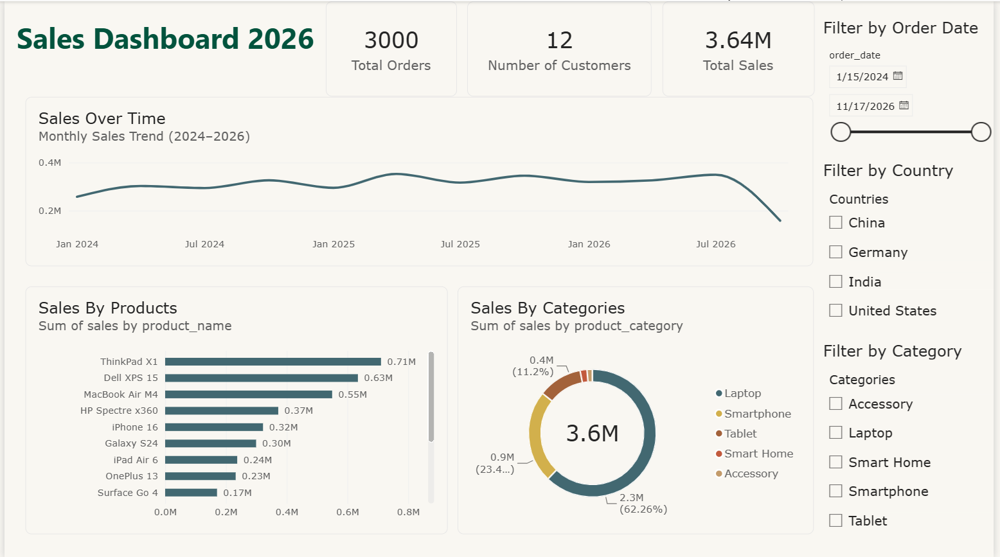

This is a personal project I made to practice using Power BI. I used a synthetic sales dataset to build a dashboard that shows how sales change over time and which products generate the most revenue.

## Dashboard

## About the Data

I used two CSV files:

- `Sales_Orders.csv` – 3,000 orders from 2024 to 2026
- `Sales_Customers.csv` – information about 12 customers

The data is synthetic and is only used for practice.

## What the Dashboard Shows

- Total sales, orders and customers
- Sales over time
- Sales by product and category
- Filters for date, country, and product category

## Tools

- Power BI
- Power Query

## What I Did

I imported the datasets into Power BI, checked the data types, and created the dashboard using different charts and slicers. I also fixed some formatting issues with the sales values to make sure the totals were correct.

## Files

- `Sales_Dashboard.pbix` – Power BI file
- `Sales_Orders.csv` – orders dataset
- `Sales_Customers.csv` – customers dataset
- `dashboard.png` – dashboard screenshot

You can download the `.pbix` file to explore the dashboard in Power BI Desktop.
